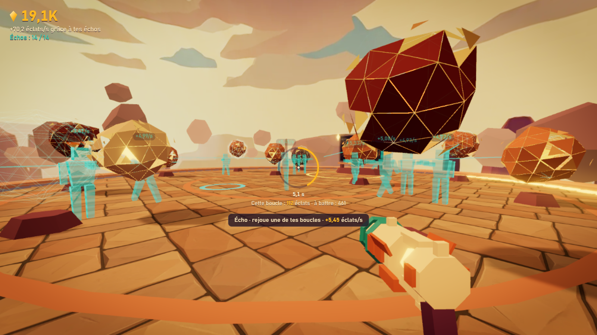
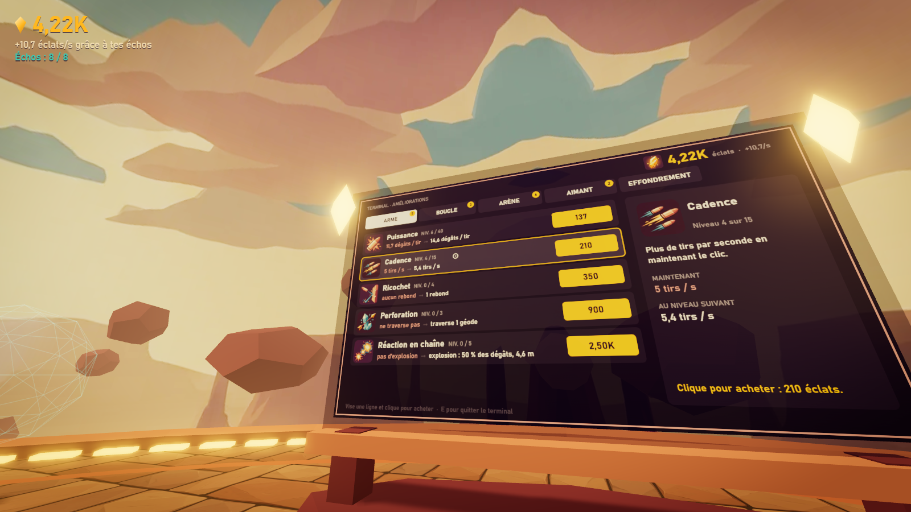

# ÉCHO

**Un FPS incrémental en boucles : tes propres parties deviennent tes générateurs.**

Tu joues une boucle de 12 secondes dans une arène flottante : tu cours, tu brises des géodes, tu ramasses leurs éclats. À la fin, un **écho** de toi apparaît et rejoue exactement tes mouvements et tes tirs, pour toujours, en te rapportant des éclats. Mieux tu joues une boucle, plus son écho rapporte. L'arène se remplit peu à peu de copies fantômes qui tirent en rythme.



## Jouer

```bash
npm install
npm run dev
```

Puis ouvrir http://localhost:5173.

**Jouer en ligne : https://francoisq890-dotcom.github.io/echo-fps-incremental/**

Le site est redéployé par GitHub Actions à chaque push sur `main` (`.github/workflows/deploy.yml`).

## Contrôles

| Action | Clavier / souris | Tactile |
|---|---|---|
| Se déplacer | ZQSD ou WASD (touches physiques, sans réglage) ou flèches | joystick à gauche |
| Viser | souris | glisser à droite |
| Tirer | clic gauche (maintenir) | bouton TIR, ou automatique sur une géode visée |
| Sauter | Espace | bouton SAUT |
| Terminal d'améliorations | E près du grand écran, puis viser une ligne et cliquer | bouton E, puis toucher une ligne |
| Pause, réglages, export/import | Échap | bouton II |

## Ce qui est fait

- **Boucle et échos** : boucle de 12 s (améliorable jusqu'à 20 s), minuteur diégétique (anneau de dalles autour de l'arène + anneau autour du viseur), enregistrement compressé (20 Hz + tirs horodatés), rejeu déterministe, emplacements limités avec remplacement de l'écho le plus faible et messages explicites.
- **Feedback** : hit-stop, recul, flash de bouche, secousse proportionnelle, géodes en 3 états de fissure, éclats qui rebondissent puis sont aspirés en spirale avec un tick de plus en plus aigu, combo visible, chiffres volants colorés selon la valeur, fin de boucle avec flash, rembobinage et matérialisation de l'écho.
- **17 améliorations en 4 familles** (arme, boucle, arène, aimant), achetées à un terminal qui est un écran dans le monde. L'arme change d'aspect sur 4 paliers.
- **5 types de géodes** : simple, mobile, blindée, dorée (rare, éphémère), explosive (chaînes).
- **4 zones** qui surgissent du vide à l'achat : arène, terrasses (rampes), passerelles et aiguille (jump pads).
- **Prestige « Effondrement »** : écran avant/après chiffré, 8 bonus permanents dont 3 proposés à chaque fois.
- **Hors ligne** : production plafonnée (8 h, améliorable) et écran de retour.
- **Tutoriel** en 11 objectifs affichés en haut, info-bulles sur les géodes, les échos, le terminal et les jump pads.
- **Sauvegarde** versionnée, automatique toutes les 10 s, export/import en texte.
- **Son** entièrement procédural (Web Audio), musique calée sur la boucle.
- **Mobile** : joystick, zone de visée, boutons, tir automatique.

## Vérifications

| Vérification | Résultat |
|---|---|
| `npm test` (Vitest) | 149 tests verts : économie, sauvegarde, hors-ligne, rejeu déterministe |
| `npm run sim` | Premier Effondrement entre 35 et 39 min sur 3 graines ; plus long trou sans achat en début de partie : 1 min 38 ; les échos restent sous le revenu actif pendant les 10 premières minutes |
| `npm run build` | OK (bundle de 180 Ko gzip, 370 Ko d'images) |
| Captures headless (`npm run shots`, Chromium avec GPU) | 60 fps avec 40 échos actifs, environ 145 draw calls, console sans erreur |

Captures regardées, dans `shots/` : [accueil](shots/01-accueil.png), [combat à 14 échos](shots/02-combat-14-echos.png), [terminal](shots/03-terminal.png), [Effondrement](shots/04-effondrement.png), [retour hors ligne](shots/05-retour-hors-ligne.png), [40 échos](shots/06-40-echos.png), [zones](shots/07-zones.png).



## Limites connues

- **Jamais joué à la main.** Le jeu a été vérifié par un pilote automatique en navigateur headless, par captures et par simulation. La sensation réelle (sensibilité, recul, volume, difficulté du trajet) n'a été testée par personne.
- **Le son n'a pas été écouté.** Il est synthétisé et s'exécute sans erreur, mais les niveaux et les timbres sont réglés sur le papier.
- **Tactile non testé sur un vrai téléphone.**
- **Performance mesurée sur une seule machine** (celle de développement, avec GPU). Une résolution adaptative baisse le pixel ratio sous 50 fps.
- **Les tirs traversent le décor** (choix assumé, voir `DECISIONS.md`).
- **40 emplacements d'échos** : le plafond existe, mais le coût le rend hors d'atteinte avant plusieurs Effondrements. La simulation en atteint 21 au premier.
- **Équilibrage après le premier Effondrement** : non simulé.
- **Arme et échos procéduraux** : la génération 3D Higgsfield a échoué ou dépassait le budget (`ASSETS.md`).

## Reste à faire

- Faire jouer un humain 40 minutes et ajuster ce que la simulation ne voit pas.
- Écouter et mixer le son.
- Équilibrer la deuxième partie (après Effondrement) et ajouter du contenu de fin de partie.
- Fusionner les petits meshes de décor pour réduire les draw calls.

## Organisation du code

```
src/config.ts          équilibrage : tous les nombres du jeu
src/echo/              pattern, simulation de boucle, enregistrement/rejeu, affichage des échos
src/economy/           état, coûts, échos, hors-ligne, prestige, sauvegarde
src/world/             géométrie logique, arène, géodes, effets
src/player/            entrées, contrôleur FPS, arme
src/ui/                terminal (canvas dans le monde), HUD, écrans
src/audio/             son procédural
src/render/            moteur de rendu et post-traitement
src/sim/, scripts/     bot et simulation, traitement des assets, captures
tests/                 Vitest
```

Voir aussi [`DECISIONS.md`](DECISIONS.md) (choix de design et de technique) et [`ASSETS.md`](ASSETS.md) (registre Higgsfield : 0 crédit payant dépensé).
